# 今日待办 · LifeLog

一个给自己用的极简深色待办本：**今天要做什么、过去哪天做了什么、未来哪天要做什么**，一眼看完。

不联网、不注册、没有账号，数据只存在你手机里。

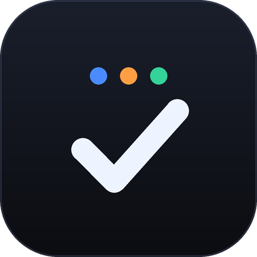

**下载 APK**：[GitHub Releases · v3.1.0](https://github.com/Mike486-ling/lifelog-todo/releases/latest)　·　[国内加速直链](https://cdn.jsdelivr.net/gh/Mike486-ling/lifelog-todo@v3.1.0/docs/download/LifeLog-3.1.0.apk)　|　[English](README.en.md)

> 直链如果被浏览器打开成文本，长按「链接另存为」或复制到下载工具里。

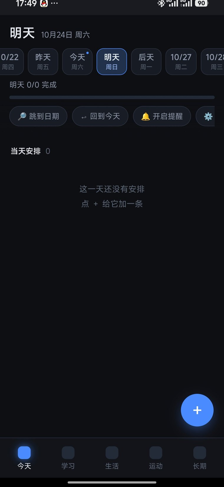　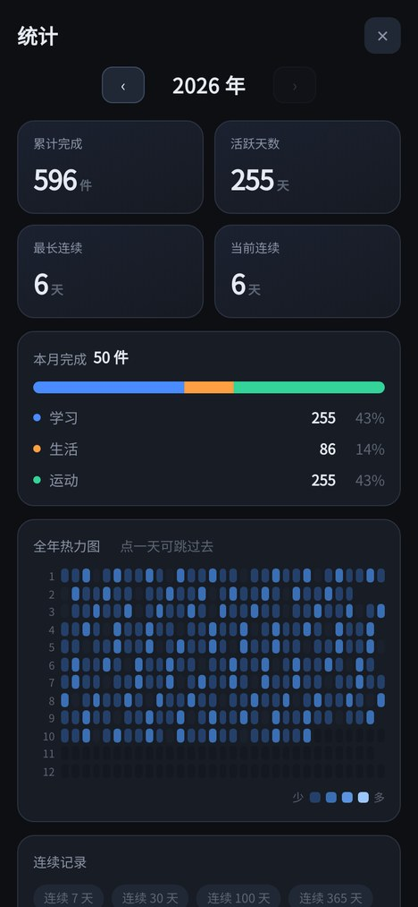

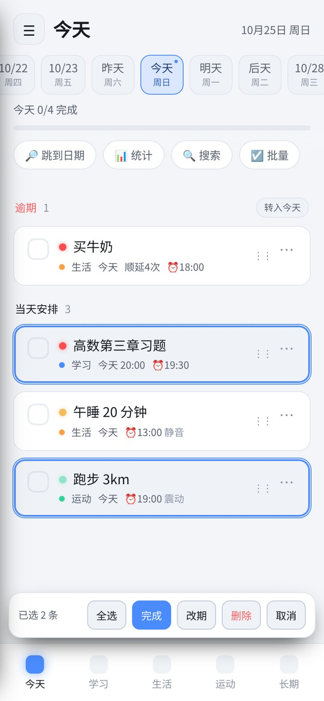　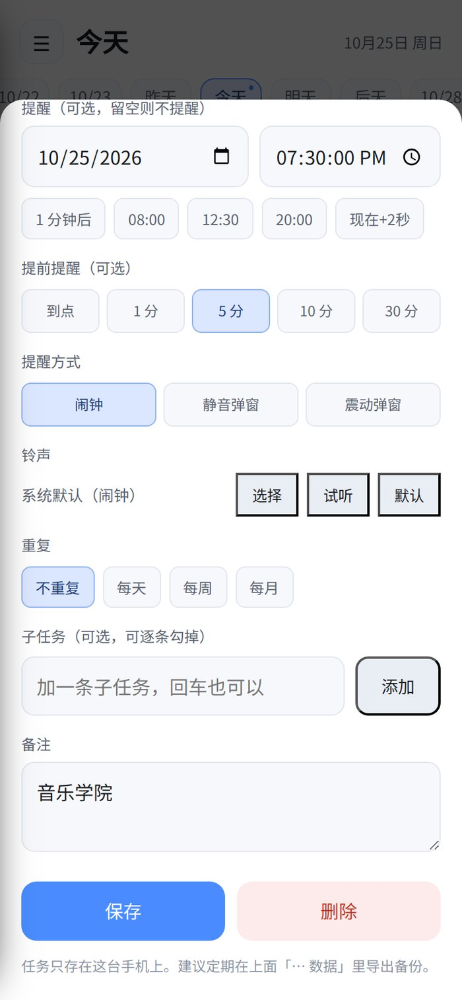

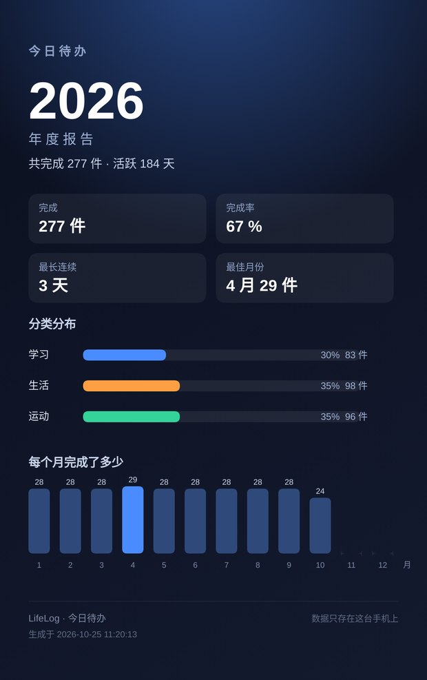

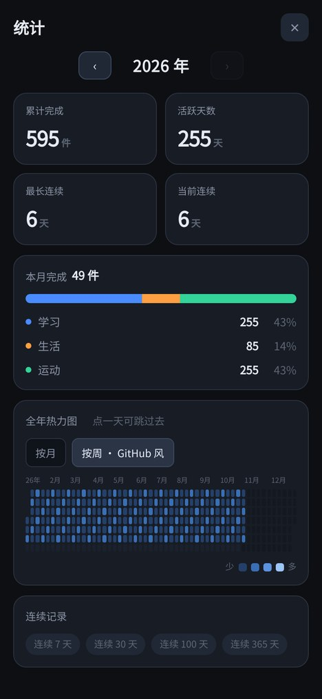　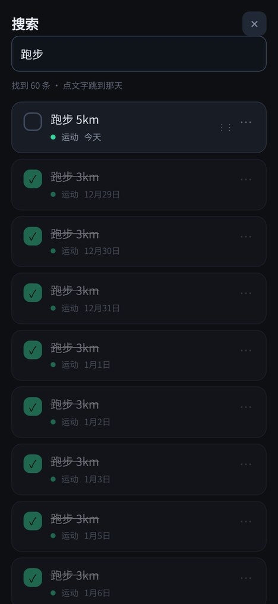

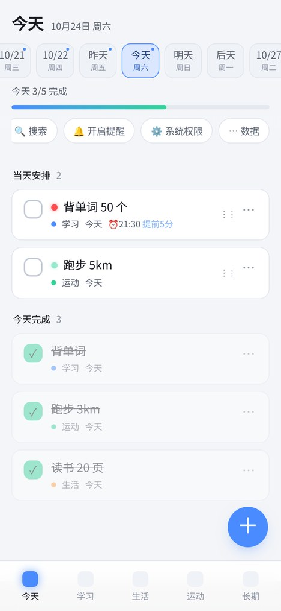　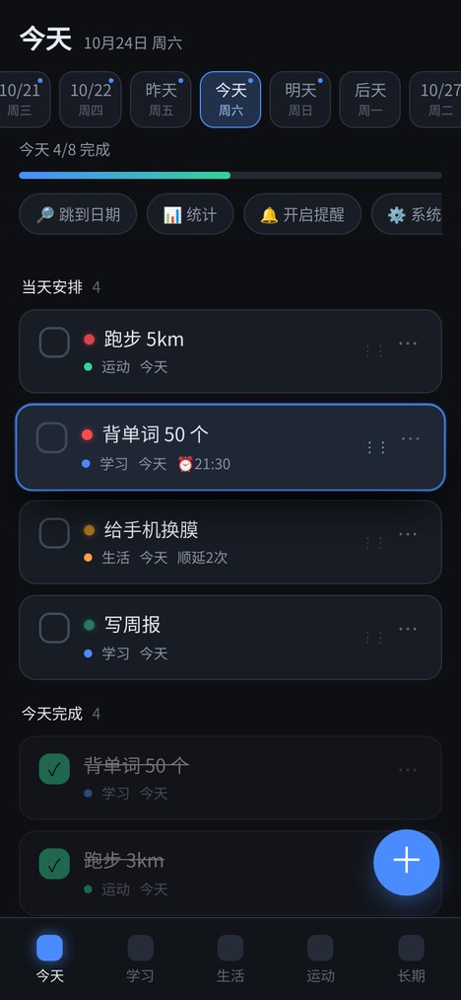

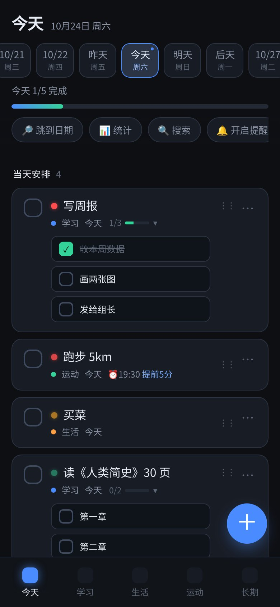　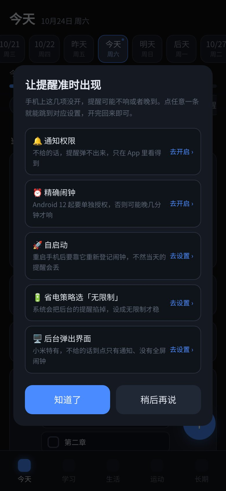

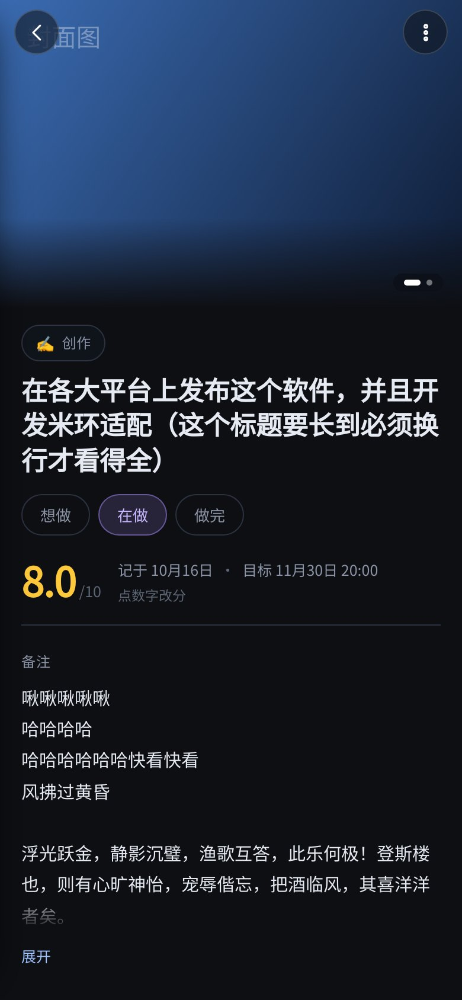　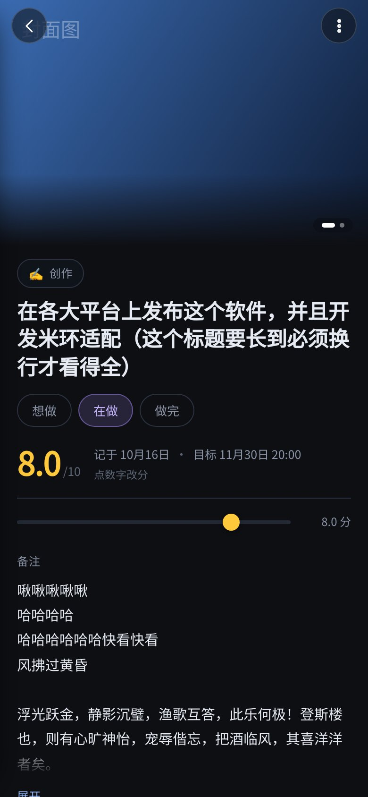

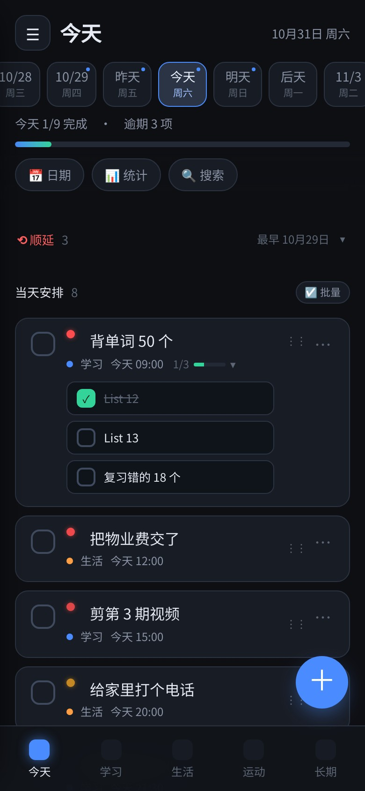

## 功能

| 功能 | 说明 |
|---|---|
| **右滑延到明天** | 任务行右滑一下就顺延到明天，提醒时间一起跟着走，带撤销条；滑动手感走 `translate3d`，跟手不抖 |
| **批量多选** | 「当天安排」标题旁的「批量」进入选择模式：全选 / 完成 / 改期 / 删除，误操作可撤销 |
| **通知栏直接办** | 通知里两个按钮：**完成**（App 下次打开时落地）、**稍后 10 分钟**，不用点进去 |
| **22:00 收尾** | 每晚定点问一句「今天还剩 N 项，要顺延到明天吗」，侧栏可关 |
| **周复盘 + 年度长图** | 统计页顶部一张本周复盘卡（完成数 / 完成率 / 环比 / 7 日柱）；「🖼 长图」把全年统计画成 1080×1720 分享图 |
| **提醒方式三档** | 每条任务可选「闹钟 / 静音横幅 / 震动横幅」，后两档不拉全屏、只出通知 |
| **任务足迹** | 改期、顺延都会记一笔，编辑面板里能看到最近 6 次，回头看这东西被推迟了多少回 |
| **点整行编辑** | 点任务任意位置就打开编辑面板，长按仍是拖动排序 |
| **重复任务** | 每天 / 每周几（可多选）/ 每月几号；勾完成自动生成下一次，取消完成会撤掉那次 |
| **子任务** | 一条任务可拆几条子项，**主页就直接铺在下面逐条勾**，不用进编辑页；进度条 2/3 可点开／收起 |
| **任务配图** | 一条任务最多 9 张，自动按 EXIF 转正、长边压到 1600px；点开全屏左右滑，图片不上传 |
| **长期详情页** | 影视 / 书 / 音乐 / 知识等 13 类，三档状态、0~10 分、多图轮播、备注 8 行折叠、子任务和改期足迹 |
| **每日任务** | 每天自动排今天 + 明天两条；漏做的不消失，进「顺延」区；完成率不把顺延算进分母 |
| **侧边栏** | 左上角 ☰ 打开，本周概览、外观、权限自检、数据、设置都在里面 |
| **铃声** | 每条任务可选系统铃声，能试听；不选就跟随全局默认 |
| **剪贴板导入** | 从别处复制的清单直接拆成多条任务，自动识别日期时间 |
| **模板组合** | 内置晨间/睡前/周末/出门前 4 套，也能把今天的任务存成自己的模板 |
| **单手模式** | 整页缩到 85% 钉在右下角，单手够得着 |
| **开屏动画** | 图标呼吸 + 进度交接，可关 |
| **首次引导** | 第一次打开列清 5 项必要权限（通知／精确闹钟／自启动／省电策略／后台弹出界面），点一条直接跳到对应设置 |
| **快速添加** | 标题直接写「明天8点 跑步 30分钟」，自动识别日期、时间、分类并填入，标题只留正文 |
| **搜索** | 顶部「🔍 搜索」跨所有日期搜任务和备注，点结果直接跳到那天，可在结果里勾完成 |
| **删除可撤销** | 删掉的任务会在底部留 5 秒「撤销」，误删能救回来 |
| **外观** | 深色 / 浅色 / 跟随系统三档，数据菜单里切换 |
| **日期条** | 首页顶部可左右滑的日期栏，今天／明天／后天直接显示，也能一直翻到过去和未来；有任务的日子带蓝点 |
| **快速跳转** | 点「🔎 跳到日期」可选任意年月日，日期条自动滚过去；另有一年前、30 天前、今天、30 天后等快捷项 |
| **三个板块** | 学习 / 生活 / 运动，各自独立管任务；任务可随时改分类 |
| **长期想法** | 单独的「长期」板块，记「以后可能做」的奇思妙想，带「还有 X 天 X 小时」倒计时 |
| **秒级提醒** | 时间精确到秒；到点触发**系统闹钟**：亮屏、覆盖锁屏、循环响铃（走闹钟音轨，静音也响）、震动，必须手动关 |
| **稍后提醒** | 闹钟界面可选「5 / 10 / 30 分钟后再提醒」 |
| **提前提醒** | 每个任务可设「提前 1/5/10/30 分钟」先响一次，免得正好在忙 |
| **逾期不丢** | 昨天没勾的任务会滚到今天顶部，标红「逾期 N 天」 |
| **开机恢复** | 重启手机后自动重建全部闹钟 |
| **拖动排序** | 长按 0.6 秒拿起，行跟手走、邻居平滑让位，拖到屏幕边缘还能自动滚动；松手即保存 |
| **优先级圆点** | 待办前的圆点按当天剩余任务数自动红／黄／绿渐变，也可手动固定颜色 |
| **年度统计** | 累计完成、活跃天数、最长／当前连续、分类占比、全年热力图；点某一天直接跳过去。热力图有「按月」和「按周（GitHub 风）」两种排法 |
| **日历导出** | 在「⋯ 数据」里可把提醒导成 `.ics` 导入系统日历，适合分享给只用网页版的人 |
| **自动备份** | 每周自动存一份 JSON 到 `下载/今日待办备份/`，也能在数据菜单手动备份 |
| **通知栏进度** | 下拉通知就能看到「今天 4/8 完成 · 还剩 4 项」，点一下回到 App |
| **备份** | 一键导出 / 导入 JSON 备份 |

## 两种用法

### 1. 网页版（零安装）

直接用手机浏览器打开 `web/app.html`。「添加到主屏幕」后可当 App 用。

> 局限：浏览器一般不给 `file://` 页面通知权限，所以网页版要靠导出 `.ics` 到系统日历才能"关掉也提醒"。

### 2. 安卓 App（推荐）

安装 APK，得到真正的系统级闹钟提醒。App 结构是**原生壳 + WebView**：界面还是那套 HTML，但提醒走 `AlarmManager` 精确闹钟，关掉 App、甚至重启手机都有效。

自己编译：

```bash
cd android
./build.sh          # 需要 JDK 17、aapt、zipalign、apksigner、android.jar(API 33)、d8
```

产物在 `android/build/lifelog.apk`。这是**手动打包流程，不依赖 Gradle**，在 arm64 的 Linux 上也能跑通。

## 技术实现

- **界面**：单文件 HTML + 原生 JS，无框架、无 CDN、无网络依赖，全部内联（约 145 KB，单文件无依赖）
- **存储**：`localStorage`（App 内为私有目录），支持 JSON 备份
- **提醒**：
  - 网页版 → 前台 `Notification` + 页面内计时器，或导出 `.ics`
  - App → `AlarmManager.setExactAndAllowWhileIdle` + 全屏 Intent + `MediaPlayer(USAGE_ALARM)` 循环铃声
- **原生桥**：`addJavascriptInterface` 暴露 `sync()` / `notifyNow()` / `askPermission()` / `openAppSettings()` / `setBg()` / `takeOps()` / `shareImage()` 等，网页侧检测到 `AndroidHost` 就自动切换
- **通知栏按钮**：原生侧收到操作后先记进 `PendingOps`，网页下次启动或回前台时取走执行（避免后台直接改 localStorage）

## 已知限制

- 铃声在"广播里就开始播"是为了绕过 MIUI 的后台拉界面限制；极端省电模式下仍可能被延迟
- 需要授予：通知权限、精确闹钟（Android 12+）、建议开自启动与"无限制"省电策略
- APK 为自签名，安装时系统会提示"未知来源"
- 卸载 App 会清空数据，升级请用覆盖安装

## 许可

MIT
